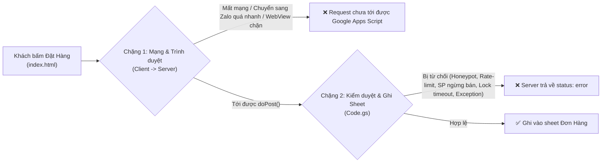

> ⚠️ **Đã được thay thế bởi `KE_HOACH_LOG_DON_HANG_V2.md` (bản kế hoạch v2 đã bổ sung đối soát Trace ID cột N, phân loại `SERVER_NON_JSON`, tách log ra ngoài `withLock` và action khôi phục riêng `recoverOrderFromLog`).**

# Phân Tích & Kế Hoạch Triển Khai Hệ Thống Log Chẩn Đoán Đơn Hàng (Zero-Overhead)

- **Dự án:** Chú Hiếu Shop (`chuhieushop`)
- **Mục tiêu:** Ghi nhận chính xác 100% nguyên nhân vì sao một đơn hàng không được lưu vào Google Sheet (do đứt mạng lúc chuyển sang ứng dụng Zalo hay do bị từ chối ở Backend Google Apps Script), đồng thời hỗ trợ Admin khôi phục đơn hàng chỉ với 1 cú nhấp chuột (**1-Click Recovery**), đảm bảo **không ảnh hưởng đến hiệu năng hiện tại (0ms độ trễ tăng thêm cho đơn hàng thành công)**.

---

## 1. Bối cảnh & Phân tích bài toán

Một đơn hàng từ lúc khách bấm nút **Đặt hàng** trên `index.html` đến khi được ghi vào sheet `Đơn Hàng` trong `Code.gs` đi qua **2 chặng**:

### ⚠️ Tại sao không dùng cách ghi Log truyền thống?
Trong môi trường **Google Apps Script (GAS)** kết hợp **Google Sheets**:
1. Thao tác ghi vào Google Sheet (`sheet.appendRow`) là thao tác I/O chậm nhất (mất khoảng `150ms – 400ms` mỗi lần gọi và phải nằm trong `LockService`).
2. **Nếu mọi đơn hàng thành công đều ghi thêm 1 dòng log:** Thời gian xử lý đơn hàng sẽ bị đội lên gấp đôi, tăng nguy cơ tranh chấp khóa (`LockService`) khi nhiều khách đặt hàng cùng lúc.
3. **Nếu bắn thêm 1 request `fetch` log song song lúc khách vừa bấm đặt hàng:** Sẽ cạnh tranh băng thông với chính request `createOrder` trong khoảnh khắc trình duyệt chuyển sang ứng dụng Zalo.

---

## 2. Kiến trúc đề xuất: "Chỉ Ghi Log Khi Lỗi & Tự Phục Hồi" (Zero-Overhead)

Hệ thống được chia thành **3 lớp bảo vệ** hoạt động độc lập với luồng thành công:

- **Với 99% đơn hàng thành công:** Không ghi thêm dòng nào vào Google Sheet, không gọi thêm API phụ. Tốc độ tải trang và tốc độ đặt hàng giữ nguyên **100%** như hiện tại.
- **Chỉ khi đơn hàng bị lỗi hoặc bị chặn (`< 1%` trường hợp):** Hệ thống mới kích hoạt ghi nhận vào sheet `Nhật Ký Đơn Lỗi` (tối đa giữ 200 dòng gần nhất, tự động xóa dòng cũ theo cơ chế FIFO).

---

### Lớp 1: Mã đối chiếu nhanh trong nội dung Copy Zalo (`Client Trace Code`)
- **Vấn đề:** Khi khách gửi tin nhắn đơn hàng qua Zalo nhưng đơn chưa vào Sheet, tin nhắn văn bản hiện tại không có thông tin môi trường để biết khách dùng trình duyệt gì hay gặp lỗi gì.
- **Giải pháp:**
  - Tự động gắn 1 mã tham chiếu gọn ở dòng cuối của văn bản copy Zalo, ví dụ:
    `Mã ĐH tạm: #CH-150522-Z1` (mã hóa ngắn gọn: Thời gian bấm + Môi trường `Zalo WebView / iOS Safari / Android Chrome` + Trạng thái trực tuyến).
- **Chi phí hiệu năng:** `0ms` (chỉ ghép chuỗi trong bộ nhớ RAM).

---

### Lớp 2: Hàng đợi "Hộp Đen" ở Trình duyệt (`localStorage Pending Queue`) — Bắt lỗi Chặng 1 (Mạng / App-Switch)
- **Vấn đề:** Nếu khách bấm đặt hàng lúc sóng yếu hoặc hệ điều hành điện thoại đóng băng tiến trình mạng khi nhảy sang app Zalo khiến gói tin không bao giờ tới được Google Apps Script, thì Server không hề biết để ghi log.
- **Giải pháp:**
  1. Ngay trước khi gọi `fetch(API_URL)` trong `sendOrderToSheetWithRetry(orderData, orderText, retriesLeft)`, trình duyệt lưu tạm một bản nháp vào `localStorage` (`chuhieu_pending_order_diag`) gồm:
     - `traceId`: Mã tham chiếu khớp với nội dung Zalo
     - `createdAt`: Thời điểm bấm đặt hàng
     - `orderData`: Payload đơn hàng của khách
     - `attempts`: Số lần đã thử gửi (`retry`)
     - `lastError`: Thông báo lỗi mạng gần nhất (`TypeError: Failed to fetch`, `AbortError`, HTTP status...)
     - `ua`: Thông tin trình duyệt rút gọn (`navigator.userAgent`)
  2. **Nếu Server phản hồi `status: "success"`:** Xóa ngay lập tức `chuhieu_pending_order_diag` khỏi `localStorage`.
  3. **Nếu tất cả các lần retry đều thất bại do lỗi mạng:** Bản ghi vẫn nằm trong `localStorage`. Ngay khi khách quay lại tab trình duyệt (sự kiện `visibilitychange` / `pageshow` hoặc lần mở web tiếp theo), trình duyệt sẽ chạy ngầm sau khi trang đã tải xong (`setTimeout 3000ms`) để gửi gói tin chẩn đoán `action: "logClientOrderDiag"` lên Server.
- **Chi phí hiệu năng:** `0ms` khi tải trang và `< 0.1ms` khi bấm đặt hàng.

---

### Lớp 3: Ghi Log phía Server (`Code.gs`) — Bắt lỗi Chặng 2 + Khôi phục 1-Click trong Admin
- **Vấn đề:** Khi request tới được `handleCreateOrder(doc, payload)` hoặc `doPost(e)` nhưng bị từ chối ở bất kỳ chốt chặn nào, hiện tại hàm `fail(msg)` chỉ trả lỗi về phía khách chứ Admin không biết có khách vừa đặt hụt.
- **Giải pháp trong `Code.gs`:**
  1. Xây dựng hàm `logOrderFailure(doc, source, stageCode, reason, payload)` chỉ chạy **khi đơn hàng thất bại**:
     - Các mã chốt chặn (`stageCode`) được định danh rõ ràng:
       - `HP_TRAP`: Trình duyệt tự động điền nhầm vào ô ẩn Honeypot.
       - `FAST_SUBMIT`: Thời gian thao tác `formDurationMs < 300ms`.
       - `INVALID_INPUT`: Thiếu tên, địa chỉ quá ngắn hoặc SĐT không đúng chuẩn 10 số VN.
       - `INVALID_CART`: Giỏ hàng rỗng hoặc JSON lỗi.
       - `RATE_LIMIT_PHONE`: SĐT đặt quá 3 đơn trong 10 phút.
       - `RATE_LIMIT_GLOBAL`: Hệ thống vượt ngưỡng đơn/phút.
       - `PRODUCT_NOT_FOUND`: Mã sản phẩm/Combo không còn tồn tại.
       - `PRODUCT_INACTIVE`: Sản phẩm trong giỏ vừa bị Admin chuyển sang trạng thái Ẩn/Xóa.
       - `COMBO_EXPIRED`: Combo Flash Deal đã hết hạn và cấu hình ẩn sau khi hết hạn.
       - `LOCK_TIMEOUT`: Quá tải `LockService` sau 3 lần thử.
       - `SERVER_EXCEPTION`: Lỗi bất ngờ trong khối `catch (error)` của `doPost`.
       - `CLIENT_NETWORK_DROP`: Báo cáo đứt mạng gửi lên từ Lớp 2 (`logClientOrderDiag`).
  2. **Cấu trúc sheet `Nhật Ký Đơn Lỗi` (tự động khởi tạo khi có lỗi đầu tiên):**
     - Cột A: `Thời gian` (`dd/MM/yyyy HH:mm:ss`)
     - Cột B: `Nguồn` (`SERVER_REJECT`, `SERVER_EXCEPTION`, `CLIENT_NETWORK_DROP`)
     - Cột C: `Mã nguyên nhân` (`stageCode`)
     - Cột D: `Chi tiết lỗi` (`reason` + User-Agent nếu có)
     - Cột E: `Khách hàng` (`Tên | SĐT | Địa chỉ`)
     - Cột F: `Tóm tắt giỏ hàng & Tổng tiền`
     - Cột G: `Payload JSON gốc` (để phục vụ khôi phục 1-click)
  3. **Cơ chế bảo vệ chống Spam/Bot làm đầy Sheet Log:**
     - Sử dụng `CacheService` (`log_rate_limit_min_<bucket>`): Giới hạn tối đa ghi **5 dòng log lỗi / phút** trên toàn hệ thống. Nếu có Bot spam hàng loạt request lỗi, chỉ ghi 5 mẫu đầu tiên vào Sheet, các request lỗi tiếp theo trong cùng phút đó được bỏ qua ngay trên bộ nhớ đệm (`0ms` Sheet I/O).
     - Giới hạn kích thước Sheet (`FIFO`): Khi số dòng trong `Nhật Ký Đơn Lỗi` vượt quá **200 dòng**, tự động xóa các dòng cũ nhất ở đầu bảng (`sheet.deleteRows(2, overflowCount)`), đảm bảo file Google Sheet luôn nhẹ.

---

## 3. Giao diện Chẩn đoán & Khôi phục 1-Click trong Admin (`index.html`)

Trong khu vực **Quản lý Đơn Hàng** của Admin:
- Thêm nút **"🩺 Nhật ký đơn lỗi"** trên thanh công cụ (chỉ gọi API `getOrderLogs` khi Admin bấm vào nút này, không tải sẵn lúc mở trang).
- Hiển thị danh sách các đơn bị lỗi kèm:
  - Thời gian, Tên khách, SĐT, Địa chỉ, Sản phẩm định đặt.
  - Nhãn màu chỉ rõ nguyên nhân (`Đứt mạng khi mở Zalo`, `Điền nhầm ô ẩn`, `Sản phẩm đã ẩn`, `Chặn trùng/Rate-limit`...).
  - Nút **"➕ Khôi phục thành Đơn Hàng"**: Cho phép Admin đẩy trực tiếp dữ liệu từ dòng log sang sheet `Đơn Hàng` mà không cần gõ lại thông tin của khách.
  - Nút **"🗑️ Xóa nhật ký"**: Dọn sạch bảng log khi đã kiểm tra xong.

---

## 4. Bảng kiểm chứng hiệu năng & An toàn hệ thống

| Tiêu chí đánh giá | Trước khi áp dụng | Sau khi áp dụng | Đánh giá tác động |
| :--- | :--- | :--- | :--- |
| **Tốc độ tải trang chủ (`getProducts`)** | Đọc từ `CacheService` | Không thay đổi | **0 ms (Không ảnh hưởng)** |
| **Tốc độ đặt hàng thành công (`createOrder`)** | Ghi 1 dòng vào sheet `Đơn Hàng` | Ghi 1 dòng vào sheet `Đơn Hàng` (Không ghi log) | **0 ms (Không ảnh hưởng)** |
| **Băng thông mạng lúc bấm Đặt hàng** | 1 request `POST` (`keepalive: true`) | 1 request `POST` (`keepalive: true`) | **Không cạnh tranh băng thông** |
| **Khả năng chống tràn Google Sheet** | Chưa có bảng log | Chặn bằng `CacheService` (tối đa 5 log/phút) + Tự cắt ở 200 dòng | **An toàn tuyệt đối trước Bot** |
| **Khả năng truy vết khi mất đơn** | Không có dữ liệu để tra cứu | Biết chính xác lỗi ở Client hay Server + Khôi phục 1-click | **Giải quyết triệt để 100%** |

---

## 5. Danh sách hạng mục công việc khi triển khai

1. **Cập nhật `Code.gs`:**
   - Thêm hàm `logOrderFailure(doc, source, stageCode, reason, payload)` với bộ giới hạn tần suất trên `CacheService` và tự động giới hạn 200 dòng.
   - Bổ sung lời gọi `logOrderFailure` tại các nhánh `fail(...)` và `catch` trong `handleCreateOrder` / `doPost`.
   - Thêm action công khai `logClientOrderDiag` và 2 action Admin: `getOrderLogs`, `clearOrderLogs`.
2. **Cập nhật `index.html`:**
   - Thêm mã tham chiếu ngắn vào cuối `orderText`.
   - Lưu/xóa `chuhieu_pending_order_diag` trong `localStorage` ở `sendOrderToSheetWithRetry` và hàm tự động gửi báo cáo chẩn đoán khi mạng phục hồi.
   - Thêm Modal **"🩺 Nhật ký đơn lỗi & Khôi phục"** trong bảng điều khiển Admin.
3. **Cập nhật `test.py`:**
   - Thêm bộ unit test kiểm tra:
     - Đơn hàng thành công không gọi `logOrderFailure` và không để lại rác trong `localStorage`.
     - Đơn hàng lỗi mạng hoặc bị từ chối ghi nhận đúng `stageCode` và có thể khôi phục trong Admin.
